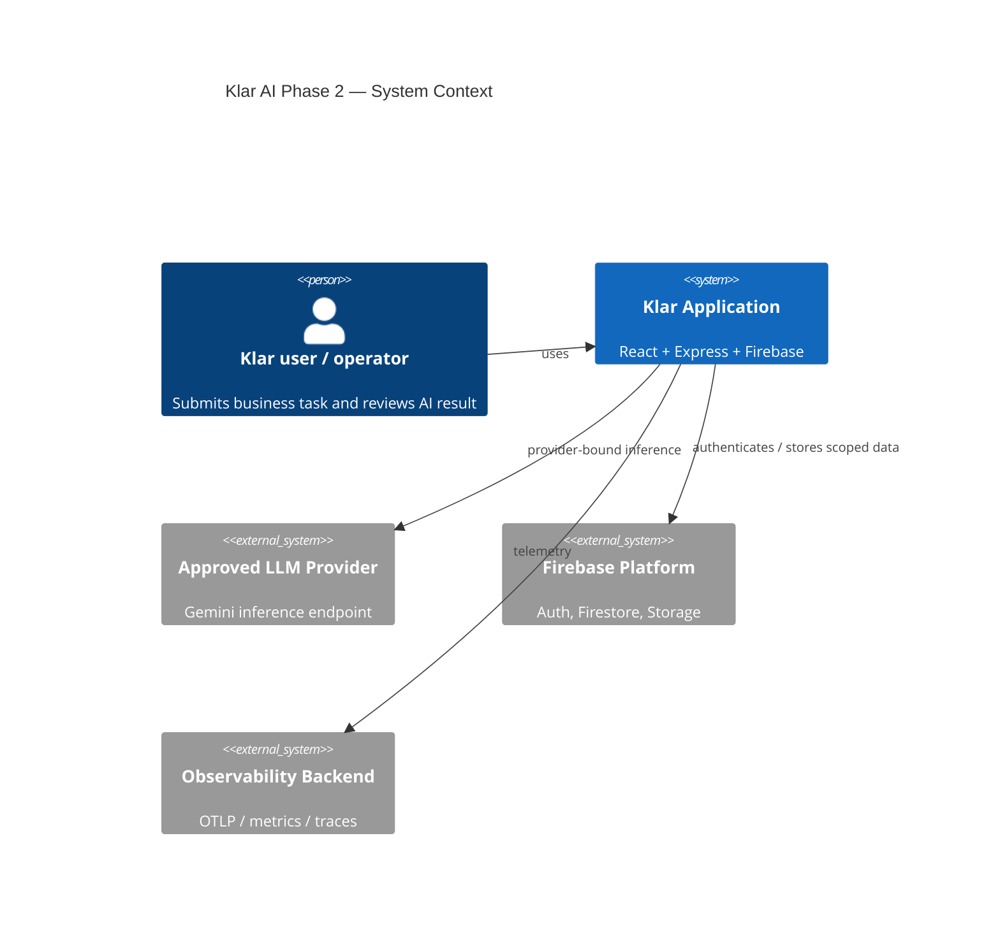
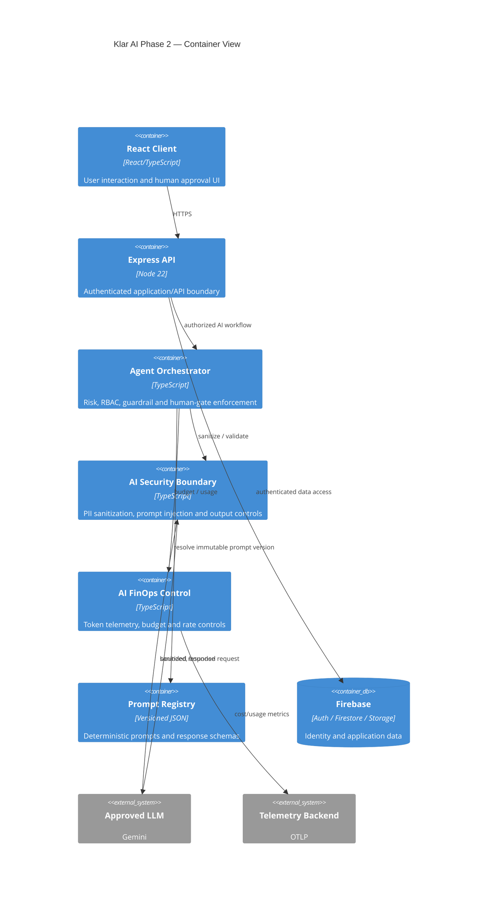
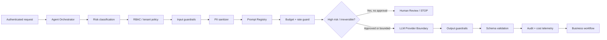

# Klar AI Phase 2 — Solution Design

**Status:** Release-Prep / Phase 2 Setup  
**Scope:** Technical Foundations, Guardrails, Agentic Orchestration & Governance  
**Baseline:** v149 security-hardened repository

## 1. Architecture principles

1. **Fail closed:** missing identity, policy, budget, schema or human approval blocks execution.
2. **Provider boundary:** no user-controlled payload leaves the application security boundary without deterministic sanitization and prompt-security wrapping.
3. **Least privilege:** an agent receives only the tools and actions required for its workflow and tenant.
4. **Human accountability:** high-risk or irreversible actions require an explicit human decision.
5. **Deterministic control plane:** policy, budgets, schemas and prompt versions are code/config; stochastic model evaluation is a separate quality gate.
6. **Tenant isolation:** cost, authorization and workflow telemetry are scoped by tenant/workflow identifiers.
7. **No browser trust:** client storage is never an authorization source.

## 2. C4 — System Context



## 3. C4 — Container View



## 4. C4 — Component View: Agent execution



## 5. Security boundaries

### Boundary A — Identity

- Firebase Auth / server authentication remains authoritative.
- Agent principals must carry a non-empty tenant and explicit role.
- Browser state cannot elevate an agent or human role.

### Boundary B — Application policy

`src/agents/orchestrator.ts` is the Phase-2 policy composition point. It does not replace the existing `src/server/aiBudget.ts` provider gateway; it adds workflow-level authorization, risk and human-review controls before execution.

### Boundary C — Provider egress

The provider receives only:

- sanitized textual data;
- explicitly bounded payload size;
- structured system instruction;
- registered response schema;
- bounded output tokens;
- an authorized provider request.

Existing provider enforcement remains in `src/server/aiBudget.ts` and `src/server/platform/aiPromptSecurity.ts`.

## 6. RAG / knowledge integration

The Phase-2 pattern is **retrieval-then-generation**, not unrestricted model browsing.

```text
User Task
   |
   v
Authorization
   |
   v
Tenant-scoped retrieval
   |
   +--> access filter / document ACL
   |
   v
PII + prompt sanitization
   |
   v
Prompt registry + bounded context
   |
   v
LLM
   |
   v
Schema + output guardrail
   |
   v
Human / workflow action
```

The current repository contains Firestore-backed application data and AI provider controls. A generic vector database or unrestricted web-search connector is **not** declared as an existing production dependency by this document. Any future RAG store must implement tenant-aware ACL filtering before retrieval results reach the provider boundary.

## 7. Data-flow rules

| Flow | Allowed | Required controls |
|---|---|---|
| Client → API | Yes | Auth, request schema, rate limit |
| API → Firestore | Yes | Firebase Auth / server authorization |
| API → Agent Orchestrator | Yes | Authenticated workflow context |
| Orchestrator → Prompt Registry | Yes | Immutable ID/version |
| Orchestrator → Provider | Yes | PII sanitization, injection guard, budget, schema |
| Provider → Business action | Only validated output | Output guard + human gate where required |
| Browser → Provider | **No** | Provider access stays server-side |
| Raw PII → external provider | **No** | Redaction / policy block |
| Agent → privileged action | Only explicit allow | RBAC + risk + human approval |

## 8. High-risk actions

High-risk or irreversible actions default to `human_review` and are not executed by the orchestrator until approval is explicit. Examples include financial transactions, permission changes, deletion of critical data and regulated decisions.

## 9. Failure behavior

- missing identity → deny;
- unknown prompt/version → deny;
- malformed budget → deny;
- hard budget cap → deny;
- prompt injection/control tag → deny;
- output schema failure → deny;
- high-risk without approval → human review;
- provider timeout → fail closed; no automatic unbounded retry.

## 10. Operational ownership

- **AI CoE:** policy, prompt registry, guardrails, reference architecture.
- **Business owner:** workflow outcome and acceptance.
- **Security:** threat model, agent permissions, incident response.
- **FinOps:** budget policy, cost alerts and unit economics.
- **Audit/Risk:** independent evidence and high-risk approval.
